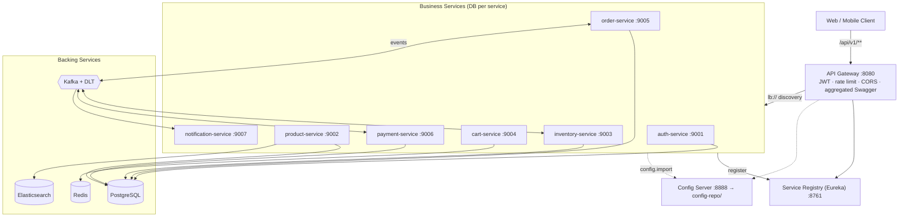

# Gesili E-Commerce — Microservices Backend

A production-style, portfolio-grade e-commerce backend built with **Java 21, Spring Boot 3.x,
and Spring Cloud**, designed as a hands-on study of real-world microservices patterns:
service discovery, centralized config, an API gateway, event-driven sagas, the outbox pattern,
CQRS, resilience, and full observability.

> **Status:** Phase 1 (foundation) in progress. See the [Phase checklist](#phase-checklist).

---

## Architecture



The order flow is an **event-driven choreography saga**:
`OrderCreated → InventoryReserved → PaymentCompleted → OrderConfirmed`, with compensating
transactions (release stock, refund) on any failure. See [`docs/`](docs/) for the full
event catalogue, saga sequence diagrams, and architecture decision records.

---

## Tech stack

| Concern | Technology |
|---|---|
| Language / framework | Java 21, Spring Boot 3.x, Spring Cloud |
| Build | Maven (multi-module monorepo) + Maven Wrapper |
| Service discovery | Spring Cloud Netflix Eureka |
| Centralized config | Spring Cloud Config Server (native backend → `config-repo/`) |
| API gateway | Spring Cloud Gateway (WebFlux) |
| Security | Spring Security + OAuth2 Resource Server, **RS256 JWT + JWKS** |
| Databases | PostgreSQL (database per service) + Flyway migrations |
| Cache / cart | Redis |
| Search | Elasticsearch (CQRS read model) |
| Messaging | Apache Kafka (event-driven, outbox, DLT) |
| Sync calls | OpenFeign (+ one gRPC demo) |
| Resilience | Resilience4j (circuit breaker, retry, bulkhead, rate limiter) |
| API docs | springdoc-openapi (OpenAPI 3) + aggregated Swagger UI at the gateway |
| Observability | Micrometer, Prometheus, Grafana, Loki + Promtail, Zipkin |
| Testing | JUnit 5, Mockito, Testcontainers, Spring Cloud Contract |
| Payments | Razorpay (default) + Stripe (via Strategy pattern) |
| Containers | Docker, Docker Compose (profiles), Kubernetes/Helm (later) |
| CI/CD | GitHub Actions |

---

## Service ports & Swagger URLs

| Service | Port | Swagger UI |
|---|---|---|
| API Gateway | 8080 | http://localhost:8080/swagger-ui.html (aggregated) |
| Service Registry (Eureka) | 8761 | http://localhost:8761 (dashboard) |
| Config Server | 8888 | — |
| auth-service | 9001 | http://localhost:9001/swagger-ui.html |
| product-service | 9002 | http://localhost:9002/swagger-ui.html |
| inventory-service | 9003 | http://localhost:9003/swagger-ui.html |
| cart-service | 9004 | http://localhost:9004/swagger-ui.html |
| order-service | 9005 | http://localhost:9005/swagger-ui.html |
| payment-service | 9006 | http://localhost:9006/swagger-ui.html |
| notification-service | 9007 | http://localhost:9007/swagger-ui.html |

Backing services: PostgreSQL `5432`, Redis `6379`, Kafka `9092`, Elasticsearch `9200`,
Zipkin `9411`, Prometheus `9090`, Grafana `3000`, Loki `3100`.

---

## How to run

### Prerequisites
- **JDK 21** (Eclipse Temurin recommended), `JAVA_HOME` set
- **Maven 3.9+** (or use the bundled `./mvnw` wrapper)
- **Docker** + Docker Compose

### Build everything
```bash
./mvnw clean verify          # Linux/macOS
.\mvnw.cmd clean verify      # Windows PowerShell
```

### Start infrastructure (per-phase, self-contained profiles)
```bash
cd infra
docker compose --profile infra up -d      # Postgres, Redis, Kafka, Elasticsearch, Zipkin
docker compose --profile phase2 up -d     # infra deps + config-server + registry
docker compose --profile full up -d       # the entire platform
```

Each `phaseN` profile pulls in its own dependencies, so you can run only what the current
phase needs — handy on a limited-RAM machine. See [`infra/README.md`](infra/README.md).

### Environment
Copy the example env file and fill in local values (never commit `.env`):
```bash
cp .env.example .env
```

---

## Repository layout

```
Gesili-E-Commerce/
├── pom.xml                  # parent POM: BOMs, versions, plugins, modules
├── mvnw / mvnw.cmd / .mvn/  # Maven Wrapper
├── common-lib/              # shared DTOs, events, enums, errors (NO entities/logic)
├── service-registry/        # Eureka server
├── config-server/           # Spring Cloud Config server
├── api-gateway/             # Spring Cloud Gateway
├── auth-service/            # custom JWT auth (RS256 + JWKS)
├── product-service/         # catalog + Elasticsearch CQRS
├── inventory-service/       # stock, reservations, TTL
├── cart-service/            # Redis-backed cart
├── order-service/           # order lifecycle, saga, outbox
├── payment-service/         # Razorpay/Stripe, idempotent webhooks
├── notification-service/    # Kafka consumer, email/SMS
├── config-repo/             # per-service, per-profile YAML
├── infra/                   # docker-compose + monitoring
├── k8s/                     # Kubernetes manifests/Helm (Phase 10)
├── docs/                    # diagrams, event catalogue, ADRs
└── .github/workflows/       # CI
```

---

## Design decisions

Key choices and their trade-offs are recorded in [`docs/adr/`](docs/adr/). Highlights:

- **Database per service** — no shared DB; services are independently deployable.
- **common-lib carries contracts, never entities** — sharing JPA entities creates a
  "distributed monolith" where a schema change in one service forces redeploys of others.
- **Choreography saga** (not orchestration) — loose coupling, no central point of failure.
- **Outbox pattern** — reliable event publishing; no lost or ghost events.
- **RS256 JWT + JWKS** — asymmetric signing; resource servers verify without a shared secret.
- **Custom auth-service** for learning; **Keycloak** documented as the production alternative.

---

## Phase checklist

- [x] **Phase 0** — Architecture, event catalogue, ADRs *(design locked)*
- [x] **Phase 1** — Parent POM, common-lib, repo setup, Docker Compose infra
- [x] **Phase 2** — Service Registry (Eureka) + Config Server
- [x] **Phase 3** — API Gateway + Auth Service
- [x] **Phase 4** — Product Catalog + search
- [x] **Phase 5** — Inventory + Cart
- [x] **Phase 6** — Order + Saga + Outbox
- [x] **Phase 7** — Payment + webhooks + idempotency
- [x] **Phase 8** — Notification service
- [x] **Phase 9** — Resilience, observability, load testing
- [x] **Phase 10** — Kubernetes + CI/CD
- [x] **Phase 11** — React/Next.js frontend

---

## License

See [LICENSE](LICENSE). Built as a learning / portfolio project.
